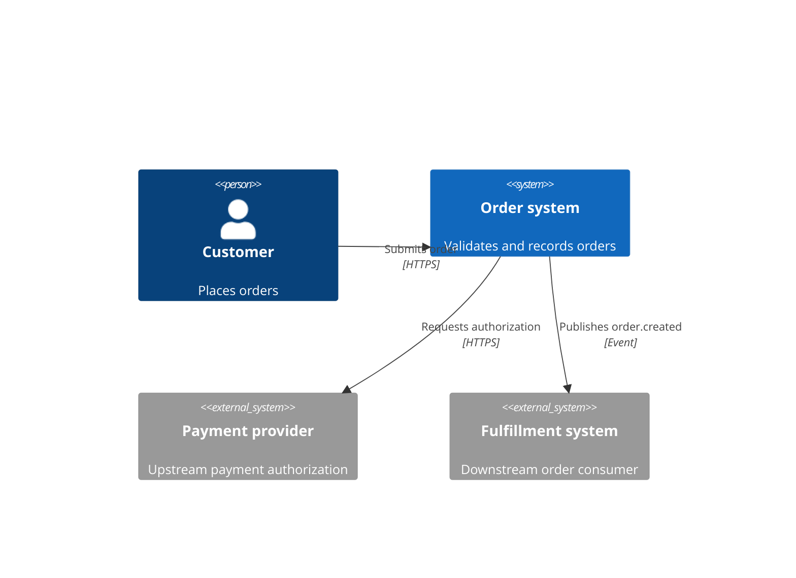
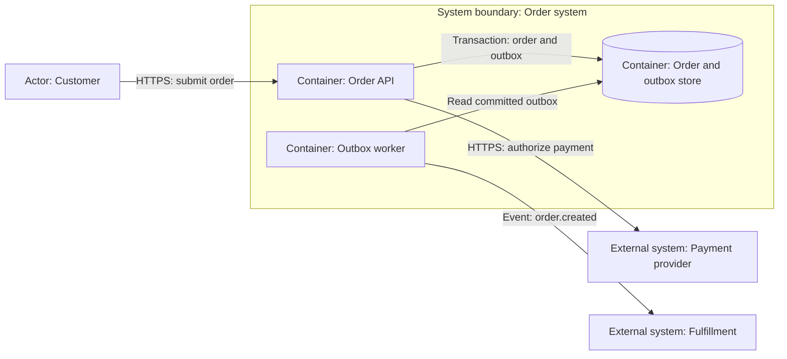
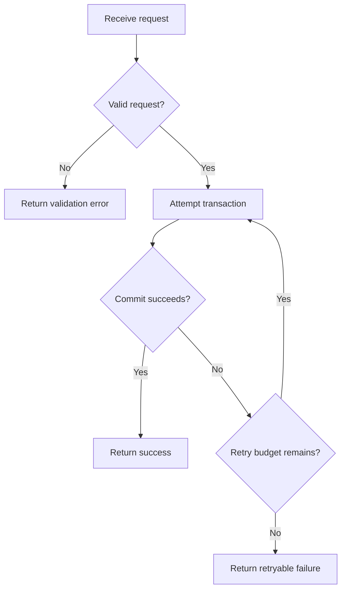
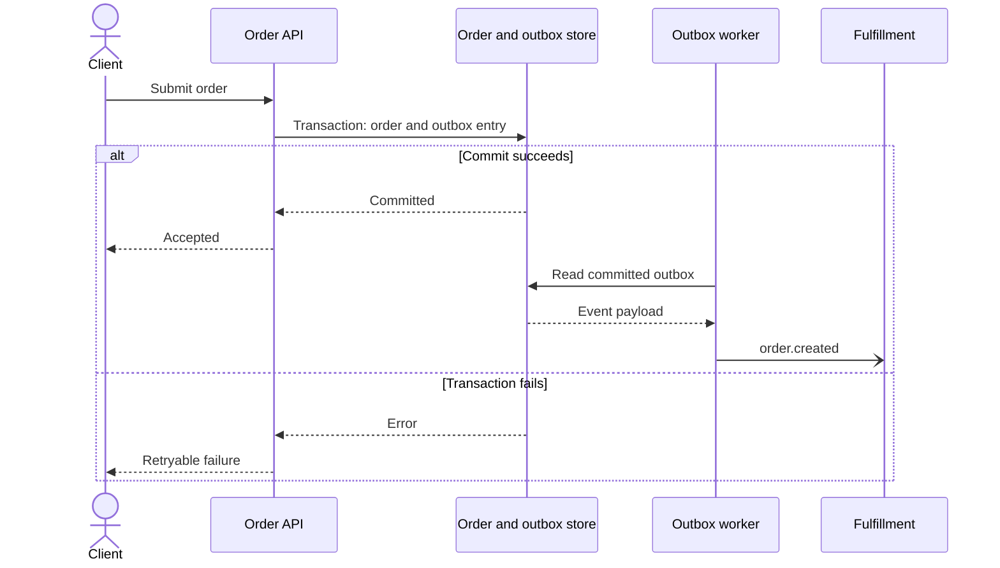
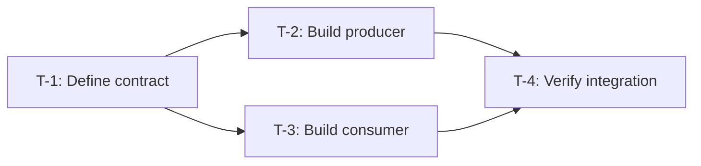

# Mermaid views for design and delivery

Select a view that answers a reviewer's question. A diagram should expose a boundary,
interaction, failure path, or dependency that prose alone makes hard to follow.
Use the fewest views that explain the change. Omit decorative diagrams.

## Choose the view

| Question                                                        | View                                      | Placement                     | Show                                                                             |
| --------------------------------------------------------------- | ----------------------------------------- | ----------------------------- | -------------------------------------------------------------------------------- |
| Who uses this system, and what systems depend on it?            | C4 context                                | Design approach               | Actors, system boundary, upstream and downstream systems, directed relationships |
| Where does responsibility or data move inside the system?       | C4 container; component only if necessary | Change by surface             | Services, applications, stores, protocols, ownership and trust boundaries        |
| What happens after a trigger, including rejection and recovery? | Process flowchart                         | Contracts or failure behavior | Trigger, decisions, branches, terminal outcomes and recovery                     |
| Who calls or emits what, and in which order?                    | Sequence diagram                          | Contracts or failure behavior | Participants, requests, responses, async events, writes, error alternatives      |
| Which task output is required by another task?                  | Task DAG flowchart                        | Plan                          | Canonical T IDs, real prerequisite edges, parallel entry branches and join       |

C4 is a model of abstraction levels. A C4 container is an application or data store,
not necessarily a Docker container. Keep each view at one level.
Do not mix deployment hosts with business steps in a container view.
Do not turn a task DAG into a runtime architecture diagram.

## Meaning and traceability

Place a caption and short explanation beside every Mermaid block. Include:

- The question it answers, scope, and whether it shows current or proposed behavior.
- A DG ID when machine-registered, and the related FR, DES, D, or T IDs.
- Sources for current relationships and decisions for proposed relationships.
- A plain-text summary of important branches or boundaries.
- The renderer or parser version, validation result, and untested rendering limits.

Label arrows with their meaning, such as `HTTPS request`, `event: order.created`,
or `requires schema output`. Identify upstream providers and downstream consumers from the depicted system's perspective.
Distinguish a request from a published event. Use async arrows only for async behavior.
Include relevant timeout, retry, rejection, or rollback paths instead of showing only success.
Mark uncertain relationships in the caption or legend; do not invent interfaces to complete a picture.
Keep entity names consistent with contracts and source. Split crowded diagrams by question or scope.
A diagram does not replace contract definitions, verification expectations, or decision acceptance.

## Portable syntax and C4 fallback

Use fenced `mermaid` blocks. Prefer established syntax, short stable node IDs,
and quoted labels. Avoid renderer-specific themes, HTML, icons, clickable scripts, and remote assets.
For flowcharts, avoid reserved words as node IDs, such as lowercase `end`.

Mermaid's native C4 syntax is experimental. Check support in the intended renderer.
If native C4 is unsupported or uncertain, use a standard `flowchart` with subgraphs,
explicit actor/system/container labels, and a caption stating the C4 level.
This is a C4 model expressed with flowchart notation. Do not silently drop boundaries.
Record unavailable rendering honestly; do not claim a parser check proves the host renders the diagram.

Official syntax references: [C4](https://mermaid.js.org/syntax/c4.html),
[flowcharts](https://mermaid.js.org/syntax/flowchart.html), and
[sequence diagrams](https://mermaid.js.org/syntax/sequenceDiagram.html).

## Examples to adapt

These are illustrative proposed designs, not observed architecture or registered work.
Replace labels, IDs, branches, and relationships with the analyzed change.
Do not copy every example into every design.

### C4 context

Question: which external systems use or support the order service?
Proposed context view; confirm each relationship against requirements and source.
The customer submits an order. The service calls the payment provider and sends a fulfillment event downstream.

### C4 container with portable flowchart notation

Question: which containers own validation, persistence, and event publication?
Proposed container view. The API owns validation and transactional order/outbox writes.
The worker publishes persisted outbox entries to the downstream consumer.

### Process flowchart

Question: when does a request commit, reject, or retry?
Proposed behavior. An invalid request exits before the transaction.
A transaction failure retries only within the declared limit, then returns a retryable failure.

### Sequence diagram

Question: how do an order write and later event publication relate?
Proposed interaction. A failed transaction produces neither a success response nor an event.
Committed events publish asynchronously; duplicate delivery behavior belongs in the contract text.

### Task DAG

Question: which outputs must exist before integration can proceed?
Proposed delivery view. T-2 and T-3 both require the contract output from T-1.
T-4 requires both outputs. Arrows mean `needs` relationships, never decision acceptance.

Compare every DAG edge against canonical `tasks[].needs`.
Use the same task IDs and labels in the diagram, table, and JSON.
For a single task or a simple chain, the table may be sufficient.
Do not draw a completed state or runnable highlight unless current machine evidence supports it.
