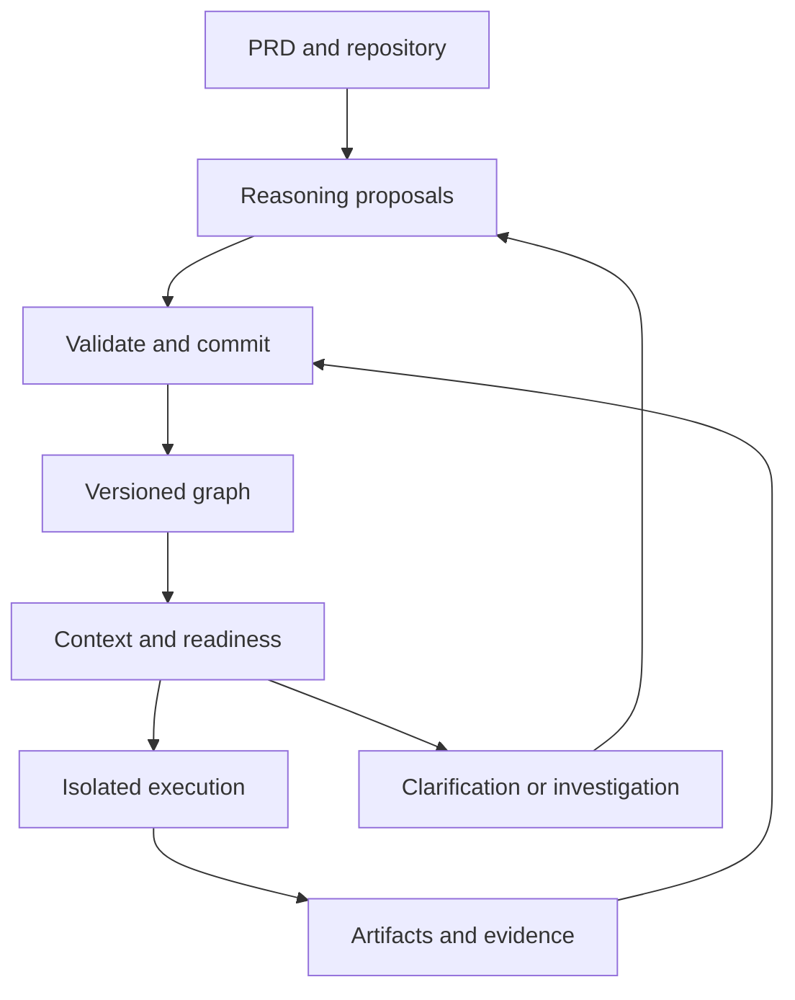

# Versioned Solution Graph Harness Technical Specification

## 1. Contract status and normative language

MUST, SHOULD, and MAY describe the proposed harness contract. They are not claims that this bundle implements the production behavior. The reference checker implements the structural and selected semantic checks listed in its README. The production acceptance backlog includes additional integration, authorization, storage, scheduler, and recovery tests.

Use JSON Schema Draft 2020-12. Every concrete document schema declares `$schema` and an immutable `$id`. `common.schema.json` and `api.schema.json` are definition libraries; validate concrete documents or named definitions, not those library roots. Schema references resolve through a frozen local registry, never by fetching a URI supplied by a model or package. Draft 2020-12 supports explicit schema identifiers and references. [S1]

The `https://schemas.example.org/vsg/1.0.0/` identifiers are reserved example identifiers, not hosted endpoints. Before shipping, adopt an organization-owned namespace and regenerate all references and digests together.

## 2. Guarantees and limits

| Deterministic under frozen inputs | Requires semantic or operational evidence |
|---|---|
| Schema validation, ID/reference checks, cycle detection, stable task ordering | Correct interpretation of a PRD |
| Context assembly from recorded selections, source bytes, and loader rules | Discovery of all relevant requirements or repository facts |
| Valid state transitions and expected-revision checks | Adequacy of a design or generated tests |
| Replaying recorded orchestration decisions | Fresh model outputs or changing external systems |
| Computing declared dependency impact candidates | Completeness of graph relationships |

Treat model invocations as recorded activities. Persist input/output artifact references, model route and version when exposed, skill version, budget, and invocation identifier. Recorded playback can reuse the captured response. A fresh call can return a different proposal.

## 3. Schema map

| File | Validates |
|---|---|
| `common.schema.json` | Shared scalar, reference, artifact, budget, authority, and projection definitions |
| `node-content.schema.json` | Model-proposable node content |
| `node.schema.json` | Runtime-assigned immutable node revision |
| `relation-content.schema.json` | Proposable pinned relationship |
| `relation.schema.json` | Immutable relationship revision |
| `package.schema.json` | Unified export snapshot |
| `proposal.schema.json` | Atomic graph mutation proposal |
| `review-request.schema.json` | Request to accept or reject exact node revisions |
| `context.schema.json` | Frozen context manifest and coverage outcome |
| `attempt.schema.json` | Runtime execution attempt snapshot |
| `operation.schema.json` | External effect ledger snapshot |
| `verification-result.schema.json` | Observed checks pinned to criteria/code/environment |
| `event.schema.json` | Transactional outbox envelope |
| `extension-registry.schema.json` | Trusted extension configuration |
| `risk-extension.schema.json` | Example extension payload |
| `api.schema.json` | Named request DTOs and error envelope |
| `skill-invocation.schema.json` | Runtime-bound skill/model invocation |
| `skill-result.schema.json` | Untrusted typed model response |

Core envelopes reject unknown properties. Extension bags intentionally accept named envelopes whose payload shape is validated separately by the trusted registry. Closing base objects and then adding fields through `allOf` is a common extension trap; this design extends explicit payload slots instead. [S2]

`Harness.schema.json` embeds all eighteen schema resources and validates unified packages as a single file. It performs core structural validation; extension payload schemas are still selected and applied through the trusted registry. The schema manifest fingerprints the eighteen modular resource files, not this derived distribution bundle.

## 4. Identity, revisions, and snapshot meaning

### 4.1 Immutable records

A node has a stable `node_id` and integer `revision`. An edit preserves identity and creates revision N+1. A concept replacement creates a new ID and an explicit `supersedes` relation. Relation identities follow the same rule. Revision numbers are scoped to identity, not globally unique.

An exact `NodeRef` is `{ "node_id": "REQ-cancel", "revision": 1 }`. No implicit latest-version references are permitted in accepted relations, contexts, or evidence. Package snapshots include historical records required by their references, not only current heads.

Node content contains `kind`, `title`, `body`, epistemic classification, provenance references, and extension envelopes. Runtime metadata adds revision, creation time, and authenticated creator. Authority and execution are separate projections. A worker proposal cannot supply a revision, creator, timestamp, acceptance, or success state.

### 4.2 Current projections

`node_states` selects exactly one current head per stable node ID and projects authority and validity. `relation_heads` selects exactly one active revision per relationship identity; retiring a relationship removes its head while retaining its history. `task_states` contains exactly one execution projection for each current TASK head.

Authority states: PROPOSED, ACCEPTED, REJECTED, SUPERSEDED. Validity: CURRENT, NEEDS_REVIEW, STALE. Runtime ingestion can accept SOURCE observations under configured policy. Other accepted heads require compatible authority records from authenticated decision processing. Exported records are evidence of platform history only when obtained through a trusted export/restore route.

`package_revision` increments for semantic graph, authority, policy-binding, lifecycle, or validity-disposition changes. Attempt heartbeats and tool receipts advance `event_sequence` and their per-record `state_version` without changing graph revision. Every export is read from one consistent transaction snapshot and includes its event watermark. This avoids invalidating every proposal on a heartbeat while preserving runtime ordering.

`exported_at` is transport metadata. It MUST NOT enter context content/cache keys. Do not hash entire changing export documents to identify stable task context.

### 4.3 Parsing and bounds

Reject duplicate JSON keys, non-finite numbers, invalid UTF-8, and unsupported schema versions before schema validation. v1 timestamps use UTC RFC 3339 strings ending in Z. Core integer fields fit the interoperable safe-integer range. Money and metric values are non-negative decimal strings, avoiding binary floating-point ambiguity. Signed metrics require an explicit schema revision or registered extension.

Proposed initial configurable limits: 10 MiB request body, 100,000 node revisions, 100,000 active relations, 10,000 tasks, 64 extension envelopes per object, and 20,000 characters for ordinary text fields. Schema array bounds are broad wire-format ceilings; the runtime MUST enforce workload and traversal limits before allocating or executing work. Raising limits requires evaluation, not just a schema edit. Large histories require filtered closed exports or a future paginated exchange contract; do not silently emit incomplete reference sets.

## 5. Typed nodes and source semantics

| Kind | Meaning and additional runtime checks |
|---|---|
| SOURCE | Pinned locator/revision and ingested artifact. Source content is DATA. Loader validates bytes and availability. |
| GOAL / METRIC | Outcome and post-delivery measurement. METRIC references cannot substitute for build verification. |
| REQUIREMENT | Testable requested behavior. Accepted MUST requirements need current acceptance criteria. |
| ACCEPTANCE | Given/when/then condition and method, linked to requirement revisions. |
| CONSTRAINT | Scope-dependent limitation. Mandatory applicable constraints are included without requiring a local edge. |
| QUESTION / ASSUMPTION | Open/resolved/deferred uncertainty. Resolution points to a decision. Deferral needs policy and consequence review. |
| DECISION | Choice, alternatives, rationale, and referenced questions. Acceptance is projected from authority records. |
| DESIGN | Requirements/constraints, decisions, external contracts, and failure behavior. |
| TASK | Inputs, output slots, verification expectations, resource claims, budget, and stopping conditions. |
| VERIFICATION | A check plan. Observed outcomes are separate result records. |
| EXTENSION | Domain node with registered type/version and validated payload. No implicit task semantics. |

Payload references and typed relations both participate in reference resolution and impact analysis. The runtime builds one dependency index from both; it must not infer independence because a payload reference lacks a parallel relation. Redundant explicit links must agree.

Source revision and repository commit pins are factual claims until adapters resolve and ingest them. Artifact SHA-256 validates integrity against trusted bytes; a digest copied from untrusted JSON is not proof of authenticity.

## 6. Relationship semantics

Edges point from the dependent/claiming object toward what it depends on, except symmetric conflicts and the explicitly documented resolution/supersession forms.

| Kind | From | To | Scheduling / impact interpretation |
|---|---|---|---|
| `derived_from` | Any knowledge node | SOURCE or DECISION | Provenance dependency; reverse traversal finds derived candidates. |
| `addresses` | DESIGN or DECISION | REQUIREMENT or CONSTRAINT | Satisfaction claim; does not prove fulfillment. |
| `implements` | TASK | DESIGN, REQUIREMENT, or CONSTRAINT | Task justification; reverse impact reaches implementation work. |
| `requires` | TASK | TASK | Dependent to prerequisite; body names required prerequisite output IDs. |
| `checks` | VERIFICATION | ACCEPTANCE or CONSTRAINT | Coverage plan; passing result required separately. |
| `resolves` | DECISION | QUESTION or ASSUMPTION | Resolution claim; only accepted decisions resolve production uncertainty. |
| `supersedes` | New concept/revision | Prior concept/revision | History relation; not a task prerequisite. |
| `conflicts_with` | Any node | Any different exact node revision | Symmetric conflict view; relevant unresolved conflicts block readiness. |
| `extension` | Node | Node | Registered domain semantics; cannot silently become a prerequisite. |

Artifact production is represented by `producer_attempt_id`, attempt output slots, and receipts. Artifacts and attempts are runtime records, so v1 does not encode them as node-to-node `produced_by` edges.

Enforce an acyclic active `requires` projection. Other conceptual relations may cycle. For an initial release, every `requires` edge is an AND prerequisite. OR dependencies and optional prerequisites require a future contract with explicit semantics.

Reject dangling or cross-tenant references, incompatible endpoint types, nonexistent prerequisite outputs, duplicate active relationship heads, active `requires` links to superseded task heads, and task self-prerequisites. Historical non-prerequisite links may retain old endpoints for change analysis; they cannot satisfy current execution without an accepted compatibility disposition.

## 7. Extensibility and compatibility

### 7.1 Annotation envelope

```json
{
  "extensions": {
    "org.acme.delivery_risk": {
      "version": "1.0.0",
      "data": {
        "score": 35,
        "rationale": "Shipment race needs integration coverage.",
        "reviewer_group": "orders-engineering"
      }
    }
  }
}
```

Register its payload schema in trusted deployment configuration. Validate registry schema digests against local files, name/version uniqueness, allowed locations, and payload shape. The included registry allows this annotation on PACKAGE and NODE. It has no scheduling or authorization effect.

### 7.2 Domain nodes and relationships

Use `kind: EXTENSION` for a custom node and `kind: extension` for a custom edge. Their bodies contain `type_name`, `type_version`, and `data`. Registry roles NODE_TYPE and RELATION_TYPE select payload schemas and trusted handler identifiers. Handlers must define endpoint rules, context contribution, dependency impact, and bounded resource behavior before they can affect execution.

Do not add an arbitrary new core enum value, executable expression, shell command, or approval rule to a package and expect the runtime to execute it. Handlers are deployed code selected by the trusted registry, not downloaded or imported from payload data.

### 7.3 Unknown extensions

Strict operational mode rejects unregistered names/versions with EXTENSION_UNREGISTERED. A future draft-import mode MAY preserve unknown annotation envelopes for round-trip editing, but MUST mark them unsupported and prohibit their use in readiness, context, or authority. Unknown execution-affecting extensions always block operational use.

Because core objects are closed, even adding an optional core field is a compatibility change for an older strict reader. Release a new immutable schema bundle, declare supported reader versions, and run explicit migration. Major changes alter semantics or required fields. Minor changes may add opt-in capability negotiated by reader versions. Patch versions correct descriptions or validation bugs with compatibility assessment. Never replace schema bytes at an existing `$id`.

## 8. Persistence and transaction model



The commit boundary accepts proposals and validated observations. Execution can send new questions or changes through that boundary without overwriting accepted history.

Recommended initial storage: PostgreSQL normalized identities/references with JSONB content, and object storage for artifact bytes. Key tables below are service contracts, not an included production migration.

| Table | Key / essential columns |
|---|---|
| initiatives | `(tenant_id, initiative_id)`, package_revision, event_sequence, lifecycle, policy binding |
| node_revisions | `(tenant_id, initiative_id, node_id, revision)`, kind, content JSONB, created_by, created_at |
| node_heads | `(tenant_id, initiative_id, node_id)`, revision, authority, validity |
| relation_revisions / relation_heads | Composite tenant/initiative/relation keys, pinned endpoint columns, kind, body |
| authority_records | Tenant-scoped record ID, exact node FK, actor, decision, policy, evidence references |
| proposals | Proposal ID, expected package revision, request digest, command artifact, validation/disposition |
| change_dispositions | Old/new/affected exact refs, rationale, accepted disposition and policy |
| contexts | Context ID, exact task FK, graph revision, loader/tokenizer versions, artifact manifest |
| task_states / attempts | Current task projection, state versions, exact task/context, lease/fence, observed outputs |
| resource_leases | Canonical claim key, attempt, expiry, monotonically increasing fence token |
| operations | Operation ID, attempt, action, sink idempotency key, request digest, state version, receipt |
| artifacts / verification_results | Ingested digests and byte locations; pinned criteria/code/environment/results |
| command_receipts / outbox | Tenant-scoped idempotency receipt; initiative sequence and event envelope |

Every FK includes tenant and initiative scope. Normalize graph endpoint columns for actual FK constraints; embedding IDs in JSONB alone does not provide referential integrity. Keep normalized values and content references consistent through transactional writes. Index reverse endpoints, kind, active heads, task state, operation state, and unconsumed events.

Use an application role without table ownership or BYPASSRLS, FORCE ROW LEVEL SECURITY where applicable, and transaction-local authenticated tenant context. PostgreSQL owners and privileged roles have bypass behavior that must be handled explicitly. [S3] RLS supplements API authorization, artifact access checks, and workspace isolation.

### 8.1 Atomic commit

```text
authenticate and derive tenant/initiative/action scope
parse safely; validate request and registered extensions
begin transaction
  lock initiative row
  if operation_id exists:
    same normalized request digest -> return stored receipt
    different digest -> IDEMPOTENCY_CONFLICT
  compare expected_package_revision and expected node/relation revisions
  reject if a required source/context/policy is no longer permitted
  stage every command in memory; assign runtime revisions and provenance
  resolve all staged refs, including refs to nodes created in this proposal
  validate endpoint types, output slots, active DAG, and accepted-scope rules
  compute known impact candidates, applicability changes, and hold conditions
  commit immutable records and head changes atomically
  preserve old authority; new edited heads begin PROPOSED unless policy explicitly permits acceptance
  mark affected readiness/evidence for reconsideration in the same transaction
  increment package_revision and event_sequence
  record audit, command receipt, and outbox event
commit
```

`expected_revision: 0` means create only; N means the current head must equal N. A command set cannot write the same identity twice. Proposal commit cannot approve disputed requirements. Review processing uses an authenticated authority check and creates separate records.

Outbox delivery is at least once. Consumers deduplicate by event ID and process initiative sequence with gap handling. Do not treat an event payload as permission to perform an external action. Re-evaluate current scope at dispatch. For a database snapshot plus event log, define backup consistency and retention before relying on restoration.

## 9. API contracts

Base route: `/v1/tenants/{tenant_id}/initiatives/{initiative_id}`. Tenant path values are compared with authenticated grants, never trusted directly. All writes use body operation IDs and request digests. Return a correlation ID and structured error envelope. Document schemas are immutable API dependencies.

| Method and suffix | Request | Success / essential behavior |
|---|---|---|
| GET `/package` | None; optional revision/event watermark | 200 package.schema; consistent export. |
| POST `/imports` | package.schema | 202 draft import ID; proposed graph content only. Discard/reconstruct supplied projections and authority under import policy. |
| POST `/proposals` | proposal.schema | 201 proposal ID, validation result, base revision; no accepted graph mutation. |
| POST `/proposals/{id}/commit` | api#CommitRequest | 200 new package revision and receipt; caller needs graph-write permission. Base mismatch returns 409. |
| POST `/reviews` | review-request.schema | 200 authority record IDs and new package revision; exact target/policy authority checked. |
| POST `/contexts` | api#ContextRequest | 201 context.schema or 422 CONTEXT_INSUFFICIENT with manifest. |
| GET `/tasks/{node_id}/readiness` | None | 200 current task state, reasons, graph revision, and state version. |
| POST `/tasks/{node_id}/dispatch` | api#DispatchRequest | 201 attempt.schema after atomic readiness, budget, context, and lease checks. |
| POST `/attempts/{id}/reports` | api#WorkerReport | 200 attempt snapshot after fence/version checks; requested success is unavailable. |
| POST `/operations/{id}/observations` | api#OperationObservation | 200 operation snapshot after adapter receipt validation. |
| POST `/lifecycle` | api#LifecycleRequest | 200 current lifecycle/new graph revision; readiness and authority gates apply. |
| GET `/events?after_sequence=N` | None | 200 paginated event.schema envelopes and cursor. |

Runtime endpoints for artifact ingest and effect preparation are adapter-facing: upload bytes into authorized staging, server-compute digest/size, persist immutable Artifact, return artifact ID. Prepare an Operation before dispatch with an action from the permitted adapter registry. The schema does not carry credentials or arbitrary executable code. Presigned transfer tickets, if used, are short lived and not persisted in package exports.

Initial error mapping: 400 PARSE_INVALID or SCHEMA_INVALID; 401 UNAUTHENTICATED; 403 ACTION_DENIED; 404 RESOURCE_NOT_FOUND for inaccessible scoped resources; 409 REVISION_CONFLICT, IDEMPOTENCY_CONFLICT, LEASE_CONFLICT, FENCE_STALE, or STATE_CONFLICT; 422 REFERENCE_INVALID, GRAPH_CYCLE, CONTEXT_INSUFFICIENT, EXTENSION_UNREGISTERED, or READINESS_BLOCKED; 429 BUDGET_EXHAUSTED; 503 ADAPTER_UNAVAILABLE. Retryable flags are determined by cause and action policy, not by HTTP status alone.

Success receipt bodies include operation_id, resource_ref, package_revision where relevant, event_sequence, and correlation_id. Returning an existing receipt MUST not repeat its effect. The synthetic API DTOs in this bundle are sufficient to design adapters, but are not an OpenAPI implementation or an HTTP server.

## 10. Readiness and scheduling

### 10.0 Skill/model boundary

The runtime creates a skill-invocation envelope after binding an approved model route, a registered skill version/digest, frozen context, output schema, and effective budget. Invocation scope and skill reference MUST match the bound context. Findings and requests for more context are data, not permission to expand scope.

Validate skill-result against its declared schema, then check invocation identity, contextual provenance, proposed base revisions, referenced artifacts, and extension policy. A PROPOSAL_READY result enters the proposal processor. A WORK_REPORTED result enters fenced report processing. DECISION_REQUIRED and MORE_CONTEXT_REQUIRED route to review or bounded discovery. NO_CHANGE and UNSUPPORTED do not mark a task successful. Reject contradictory outcome/content combinations even when a future permissive schema admits them.

Bind origin metadata to the recorded invocation rather than trusting copied strings. Meter actual usage centrally. Models cannot select credentials, raise budgets, replace policy bindings, or approve their own findings.

### 10.1 Readiness predicate

A production task is eligible only if it is a current accepted TASK head, its required accepted input closure is valid, applicable mandatory constraints are available, blocking questions/conflicts have dispositions, prerequisite outputs are available and currently valid, a READY context can be compiled, and policy/budget/resource conditions permit the action.

Investigation tasks use a separate policy: an authorized question, bounded investigation, defined evidence output, and stopping conditions. They do not require the answer they are intended to discover. Open assumptions are never automatically accepted because investigation needs them.

`requires` names target output slots. A prerequisite task's SUCCEEDED state alone is insufficient: resolve the successful attempt's output artifact, its verification/acceptance policy, and the current input compatibility. Missing evidence keeps the dependent blocked.

### 10.2 Stable selection and leases

Evaluate active DAG eligibility from a consistent snapshot. Among ready tasks, order by configured priority, then stable node ID and revision. Priority lives in trusted scheduling policy or a future registered field; do not invent it from task array order.

Acquire canonical resource claims in sorted order to avoid lock-order deadlocks. MVP resource claims are exact normalized keys. A repository adapter maps paths to owned resource IDs and rejects overlapping path claims by prefix analysis; equality of arbitrary strings is not adequate file-conflict detection. For the first pilot, a repository-wide lease is acceptable.

Atomic dispatch rechecks graph revision, task state_version, context policy/digests, budgets, and leases. Allocate an attempt and monotonic fence token before releasing the transaction. All worker reports and adapter operations verify the current fence. Expired workers cannot commit output or launch a new effect.

### 10.3 Task/attempt transitions

| Transition | Guard |
|---|---|
| PENDING/BLOCKED → READY | Runtime readiness predicate holds. |
| READY → RUNNING | Atomic dispatch and valid context/lease. |
| RUNNING → VERIFYING | Outputs ingested and fenced report accepted. |
| VERIFYING → SUCCEEDED | Current completion policy and evidence pass; required review exists. |
| RUNNING/VERIFYING → FAILED | Observed failure; effects reconciled or recovery remains recorded. |
| Nonterminal → CANCELLED | Cancellation prevents further dispatch and reconciles in-flight operations. |
| Historical SUCCEEDED → current BLOCKED | Input/evidence invalidation; retain the successful attempt unchanged. |

An attempt may enter RECONCILE_REQUIRED on ambiguous interruption. It does not automatically become failed. Task projections can change without altering prior attempt outcomes. Retry creates a new attempt with its own fence/context and a bounded attempt count.

Initiative transitions: DRAFT → ACTIVE; ACTIVE ↔ PAUSED; ACTIVE/PAUSED → RELEASE_READY after current readiness; RELEASE_READY → ACTIVE on invalidating changes; RELEASE_READY → COMPLETED after authorized release disposition; DRAFT/ACTIVE/PAUSED/RELEASE_READY → CANCELLED. Cancellation stops new work; a late receipt still must be recorded. Any reopening of COMPLETED/CANCELLED requires a new initiative or a separately authorized future lifecycle contract.

## 11. Progressive context algorithm

### 11.1 Frozen inputs

Cache keys include tenant, initiative, task revision, selected exact refs and bytes, policy digest, skill digest, schema-bundle digest, loader version, tokenizer version, ordering rules, and effective budget. A broad graph revision can be a conservative invalidator, but equivalent tasks may reuse a package only after verifying the complete dependency fingerprint.

### 11.2 Mandatory selection

1. Resolve the current task, scoped required inputs, criteria, design, accepted decisions, provenance, referenced contracts, and prerequisite output evidence through a bounded typed closure.
2. Query all constraints applicable to initiative, repository IDs, or scoped node IDs. Do this independently of local graph adjacency.
3. Include relevant unresolved questions, assumptions, conflicts, accepted dispositions, and policy restrictions. Investigation contexts preserve uncertainty explicitly.
4. Resolve source and artifact bytes at pinned revisions. Access denial, missing bytes, or digest mismatch is a mandatory gap when the source is required.
5. Classify required knowledge versus optional supporting material. Produce a manifest of selections and omissions. Record every mandatory omission.
6. Count the complete serialized request, including trusted instructions, wrappers, data, and tool overhead, with the configured tokenizer. Apply input/output and model-window limits.
7. If mandatory material exceeds budget, return CONTEXT_INSUFFICIENT or request task decomposition. Do not silently remove it. Optional selection uses stable ranking and ID ties.
8. Serialize selected records in stable `(kind, node_id, revision)` order; relationships by `(kind, relation_id, revision)`; artifacts by artifact ID. Preserve semantic order in examples, procedural steps, and proposal command arrays.
9. Canonicalize the manifest and JSON context using RFC 8785 and compute SHA-256 over those bytes. Hash raw non-JSON artifact bytes without normalization. RFC 8785 defines interoperable canonical JSON rules, including numeric serialization and property ordering. [S4]
10. Persist bytes and manifest before dispatch. Bind the attempt to that exact context and revalidate permissions at execution.

Stored summary artifacts may be selected with their source revisions and derivation metadata. Generating a fresh summary is model reasoning, not deterministic compilation. Preserve access to decisive original excerpts and known summary limitations.

The fixture `context-rendered.json` is canonical JSON and its artifact digest is checked. Token counts use a named fixture estimator, not a production tokenizer. Production must install and test its actual tokenizer, system/skill rendering, and request envelope.

### 11.3 Discovery boundary

Compilation follows recorded facts. It cannot discover a missing dependency deterministically. A context-gap investigation searches permitted sources, proposes facts/relationships, and then triggers revalidation and a new frozen package. Log unavailable sources and stopping conditions. Do not assert completeness from a successful search.

## 12. Change impact and invalidation

Build reverse dependency indexes from provenance, body references, active relations, scope applicability, policy bindings, and evidence pins. Changed global constraints may affect nodes with no explicit local edge. Compute a bounded candidate closure, not a declaration that every descendant is wrong.

The commit transaction marks candidates NEEDS_REVIEW and blocks affected READY contexts/verification until disposition. A model may propose RETAIN, REVISE, REPLACE, or DEFER with evidence. Runtime processing checks authority, records exact old/new/affected refs, and updates validity. RETAIN must explicitly justify compatibility; stale evidence cannot become current merely through an unreviewed label.

For running work, a semantic input change prevents output acceptance against the new scope. It may still be retained as historical work. Cancel safe pending operations and invalidate commit eligibility atomically. An already-dispatched irreversible effect requires reconciliation; a new graph revision cannot undo it.

Example: cancellation changes from before shipment to before carrier pickup. Preserve the old passing result. Mark design, implementation, integration checks, and audit/race behavior as candidates. Release readiness waits for approved dispositions and current verification.

## 13. Durable execution and effect recovery

### 13.1 Effect ledger protocol

Persist PREPARED before attempting a tool/external action. An idempotency key identifies one logical effect and is scoped to tenant, initiative, adapter/action, and logical operation. It is stable across retries of that same effect; retries must not create a fresh sink key. A changed request digest requires a new logical operation or an idempotency conflict.

```text
PREPARED -> DISPATCHED -> OBSERVED -> COMMITTED
DISPATCHED -> RECONCILE_REQUIRED -> OBSERVED -> COMMITTED
PREPARED -> CANCELLED
```

OBSERVED includes a trusted receipt and confirmed success/failure. COMMITTED means the observed outcome is recorded into harness state; it does not imply the external action succeeded. Only an undispatched operation can be cancelled without an observation. Compensating an effect creates a new authorized operation, never a fictional rollback of history.

### 13.2 Adapter capabilities

Each adapter's trusted configuration declares whether it supports sink idempotency, outcome observation, reversible compensation, fencing, and cancellation. Before retrying an ambiguous effect:

1. Observe or deduplicate using the original operation key.
2. If the sink confirms an outcome, ingest the receipt and reconcile.
3. If policy and adapter guarantees establish that retry is safe, retry within budget.
4. Otherwise remain RECONCILE_REQUIRED and route to a human or recovery investigation.

A sink with neither idempotency nor reliable observation cannot provide general duplicate-effect prevention after a crash. The harness must expose that limitation and restrict unsupported operations.

Temporal can provide deterministic workflow replay when workflow code follows its restrictions. External/model calls belong in recorded Activities, and Activity retry behavior still requires idempotent application design. [S5, S6] The initiative graph remains independent of workflow-engine history; reconcile the two through operation IDs and transactional outbox events rather than assuming an atomic cross-system transaction.

## 14. Verification, success, and release readiness

A VERIFICATION node is a plan; a verification-result is an observation. Ingest observations from authenticated runners/adapters. Store criterion revisions, implementation commits, environment artifact, executed time, runner identity, and actual evidence artifact IDs. A model-generated PASS string is not accepted proof.

An accepted task completion requires every output slot, any required output validation, applicable verification plans, exact implementation compatibility, and configured review. Unit success alone does not satisfy integration or business-level criteria. Inconclusive or unavailable checks leave a gap.

Release readiness is computed over current accepted MUST requirements, mandatory constraints, evidence coverage, relevant conflict/question dispositions, successful integration checks, unresolved operations, current budget/policy, and existing organizational release authority. Business KPIs measured after deployment are monitored separately.

Artifact ingest and result registration must verify actual bytes, immutable storage references, repository existence, ownership, and runner provenance. SHA-256 without trusted ingest is insufficient. Retention deletion must preserve audit metadata while reporting unavailable evidence; it cannot preserve a fabricated claim that deleted bytes remain verifiable.

## 15. Security and operations

Enforce tenant/initiative authorization on every graph, artifact, search, context, worker, and effect path. Source snippets remain data even if they contain instructions. Use approved model routes and data classification. Keep secrets in a broker, never in package or model context exports. Isolate code execution with filesystem/network/tool capabilities appropriate to the authorized task.

Recheck authorization at dispatch and each external action, not only at context creation. Revoked policy or credentials can stop new work even when graph content remains unchanged. Bound model calls, attempts, traversal, execution time, token usage, and spend centrally.

Log transitions, actors, policies, revisions, contexts, costs, artifact integrity, and recovery outcomes with appropriate redaction. Test backup/restore across graph, outbox, artifacts, and workflow state. Reconcile in-flight effects before resuming restored work. Declare workload-specific latency, availability, RPO/RTO, retention, and concurrency targets before enterprise release; this specification does not invent operational SLOs.

## 16. Acceptance backlog

| ID | Test | Required result |
|---|---|---|
| C01 | Unknown core field or duplicate JSON key | Reject before mutation. |
| C02 | Node-content proposal supplies acceptance/actor/revision | Reject. |
| C03 | Dangling ref, wrong endpoint type, nonexistent output slot | Reject atomic proposal; no partial writes. |
| C04 | Cyclic or self-requiring task graph | Reject with identified cycle. |
| C05 | Concurrent proposals with the same base | At most one commits; the other receives revision conflict. |
| C06 | Repeated operation ID with different body | Idempotency conflict; no repeated effect. |
| C07 | Mandatory global constraint lacks task-local edge | Included through applicability query. |
| C08 | Mandatory context exceeds budget or source unavailable | Explicit insufficiency; no dispatch. |
| C09 | Same frozen context inputs under same rules | Identical canonical bytes/digest. |
| C10 | Invalid/unknown/disallowed extension payload | Reject strict operational use. |
| C11 | Expired worker reports or starts effect | Reject stale fence; retain audit. |
| C12 | Crash after external success before harness commit | Observe/deduplicate using original key; no blind retry. |
| C13 | Adapter cannot establish interrupted effect outcome | Remain unresolved; manual/recovery path. |
| C14 | Changed criterion with historical PASS | Current completion blocked pending disposition/current evidence. |
| C15 | Individually passing tasks, failing integration | Initiative remains not release ready. |
| C16 | Imported JSON claims acceptance/success | Draft/proposal only; no imported authorization. |
| C17 | Cross-tenant IDs or artifact access | No leakage; reject scoped access. |
| C18 | Cancelled/over-budget run | No new dispatch; reconcile already dispatched work. |
| C19 | Backup restored with ambiguous in-flight effects | Recovery barrier before resumption. |
| C20 | Graph tracing complete but PRD interpretation wrong | Semantic/adversarial evaluation finds or records the miss. |

The included tests cover selected C01-C04 and C07-C10 cases plus reference checks, not all production conditions. Concurrency, real authorization, fencing, durable effects, and interpretation quality require the actual harness and representative repositories.

## 17. Implementation order

1. Adopt schemas and namespace; establish tenant/policy identity and synthetic fixtures.
2. Implement safe parser, offline registry, core reference/type validation, immutable storage, optimistic transactions, and outbox.
3. Add authority processing, import policy, impact candidates, and current projections.
4. Implement context compiler, actual tokenizer, artifact ingest, and insufficient-context behavior.
5. Implement readiness, serialized worker dispatch, output registration, and verification through existing tests.
6. Add durable orchestration, adapter receipts, reconciliation, fencing, budgets, and cancellation.
7. Author the skill packages against stable input/output contracts and evaluate end-to-end behavior.
8. Add multi-worker/multi-repository scope only after isolated pilot and operational acceptance.

## 18. Primary technical sources

These references support specific platform mechanisms, not the correctness of the proposed architecture. Accessed October 5, 2026.

- [S1 JSON Schema Draft 2020-12 Core](https://json-schema.org/draft/2020-12/json-schema-core.html)
- [S2 JSON Schema object validation](https://json-schema.org/understanding-json-schema/reference/object)
- [S3 PostgreSQL row security](https://www.postgresql.org/docs/current/ddl-rowsecurity.html)
- [S4 RFC 8785 JSON Canonicalization Scheme](https://www.rfc-editor.org/rfc/rfc8785.html)
- [S5 Temporal workflow definitions](https://docs.temporal.io/workflow-definition)
- [S6 Temporal activity definitions](https://docs.temporal.io/activity-definition)
- [S7 python-jsonschema validation and format checking](https://python-jsonschema.readthedocs.io/en/stable/validate/)

The reference checker explicitly enables format checking; python-jsonschema otherwise treats format keywords as informational by default. [S7]
