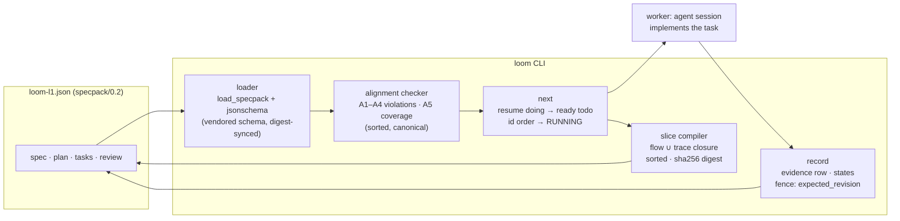

# Loom L1 — architecture

## The loop, per pass

1. `loom check` — schema + A1–A6; gaps reported in sorted order.
2. `loom next` — pick the one actionable task (resume doing → ready todo, id
   tie-break), compile its slice (task + flow closure + trace targets),
   print it with the slice digest, mark it `doing`.
3. The worker implements and runs the task's own `verify` command.
4. `loom record --task T --result pass --cmd "…" --exit 0` — evidence row
   appended, state advances. Two consecutive fails block; the revision fence
   refuses stale writers.

## Where things sit

- `DES-1` loader + validator — `loom_kit/specpack.py`
- `DES-2` alignment checker — `loom_kit/specpack.py`
- `DES-3` CLI integration — `loom_kit/cli.py` (check/next/record/status)
- `DES-4` slice compiler — `loom_kit/specpack.py`

The legacy `sdd.json` path is read-only this wave (CON-2); it retires once
specpack is ratified (golden-path-f57902a6).
