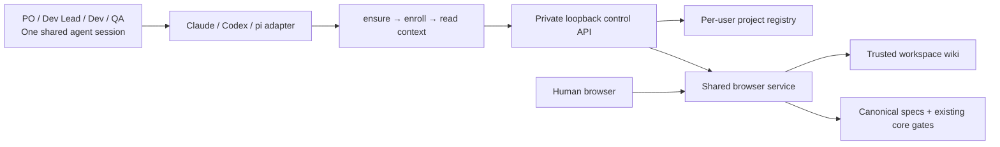

# Proposed connection design

The engine/workflow stays in core; knowledge stays in knowledge. CLI owns runtime lifecycle and project registry; web reuses current owner workflow and adds a project selector plus wiki reading/search. Hosts use a common ensure/connect/context bridge with host-specific event parsing and output.

## Control and persistence contracts

- Per-user runtime state: schema/runtime/protocol version, instance nonce, verified process identity, loopback endpoints and private control credential. Project state: schema, project ID, canonical workspace/wiki/spec roots and display label. No session ledger or prompt/usage capture.
- Startup is serialized; readiness requires a credentialed health response from the expected instance. Stop uses the service's authenticated shutdown endpoint rather than killing a descriptor PID. Unknown live process or unprovable lock ownership refuses recovery. Startup/stop races have bounded retries and explicit failures.
- Agent callbacks are short-lived ensure/connect/read operations. Session exit never stops the service. Explicit stop persists until another relevant event; there is no watchdog. Ensure survives a service crash and preserves enrollment.
- Browser and control listeners are separate, both on 127.0.0.1. Control rejects any Origin-bearing request, requires private bearer credential and validates exact configured Host. UI receives no control credential. Protect browser owner writes using same-origin/Host checks, CSRF token, project ID, held revision and shared core writer lock.
- Enrollment accepts explicit trusted roots and enforces canonical realpath containment on every read/write route. Distinct worktrees are distinct projects. No automatic enrollment of all git worktrees or home from a global install. Deleted/moved roots remain visible as unavailable until reconnect/disconnect.
- Project-qualified browser URLs avoid equal-slug collisions. Wiki/search use knowledge public APIs and bounded results. Markdown previews use an opaque sandbox without scripts/forms/top-navigation; labels are text. The UI exposes existing owner controls, not a new approval authority.
- Context uses core read-only gate derivation. Approximate `where` status is not execution authority; `nextTask` is not a read API. Missing, malformed, empty, delivered and unavailable roots are distinguishable. Preserve canonical-root precedence and legacy-only compatibility.
- Native packages and compatibility installer use one source manifest. Runtime installed, integration activated/trusted and project enrolled are separate statuses. Source/package/runtime/protocol versions are checked before enrollment; managed identity/digests delimit migrations and removals. Foreign settings survive.

## Decisions awaiting owner acceptance

### D-1

Proposal: One shared per-user background Node runtime, separate from agent lifetimes, with next-event restart and a stable reported UI address.

Reason: Avoid duplicate project servers and keep explicit stop effective while sessions are idle.

Alternatives and consequences: Foreground per-project processes are simple but fail the requested lifecycle; OS login services add unwanted restart policy.

Status: proposed.

### D-2

Proposal: Reuse the existing spec engine and owner UI; add project selection and read-only knowledge access. New packs are authored by the agent/CLI into specs/.

Reason: The owner workflow already exists; a web spec-authoring wizard and new role system would expand the task.

Alternatives and consequences: A browser authoring wizard is a separate future product slice.

Status: proposed.

### D-3

Proposal: Separate credentialed control HTTP from browser HTTP; sandbox Markdown previews on an opaque origin with scripts/forms/top-navigation disabled.

Reason: Enrollment expands filesystem reach and trusted Markdown must not acquire control-plane or owner-action authority.

Alternatives and consequences: One listener with only Origin checks is inadequate for privileged registration and hostile repository rendering.

Status: proposed.

### D-4

Proposal: Generate host-native packages from a versioned harness source manifest; bootstrap and fallback installation remain explicit.

Reason: Native hosts should manage activation/versioning while treadle owns its runtime and project enrollment.

Alternatives and consequences: Retaining only copy installation misses host lifecycle semantics; native packages alone cannot guarantee runtime availability.

Status: proposed.

### D-5

Proposal: Publish a capability matrix and prove adapters in real hosts, including Codex CLI/desktop separately and IDE compatibility configuration.

Reason: Current Codex plugin support excludes IDE; pi package metadata does not promise custom-agent installation. Trust/reload are user host actions.

Alternatives and consequences: Claiming uniform extension/agent support across every host would be unsupported. A changed contract after the compatibility spike needs an amended plan.

Status: proposed.

## Research boundary

Official documents describe current host contracts, not proof that this repository uses them. Codex plugin support and IDE hook capabilities need separate witnesses. Native pi packaging exposes extensions/skills/prompts/themes; custom-agent behavior requires separate support evidence. Native package installation cannot stand in for runtime bootstrap or host trust.

References: [Codex hooks](https://learn.chatgpt.com/docs/hooks), [Codex plugins](https://learn.chatgpt.com/docs/plugins), [Claude hooks](https://code.claude.com/docs/en/hooks), [Claude plugins](https://code.claude.com/docs/en/plugins-reference), [pi packages](https://github.com/earendil-works/pi/blob/main/packages/coding-agent/docs/packages.md), [pi extensions](https://github.com/earendil-works/pi/blob/main/packages/coding-agent/docs/extensions.md), [Node detached processes](https://nodejs.org/download/release/latest-jod/docs/api/child_process.html).

Observed local versions during research: Codex 0.162.1, Claude Code 2.1.233, pi 1.1.0, Node 24.19.0. These are version observations, not adapter verification. Native macOS/Windows and separate Codex desktop/IDE witnesses are not yet available in this Linux session.
