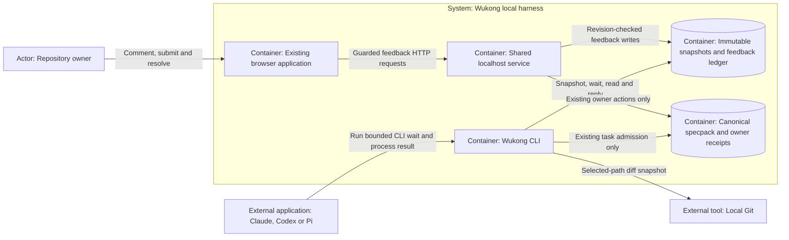
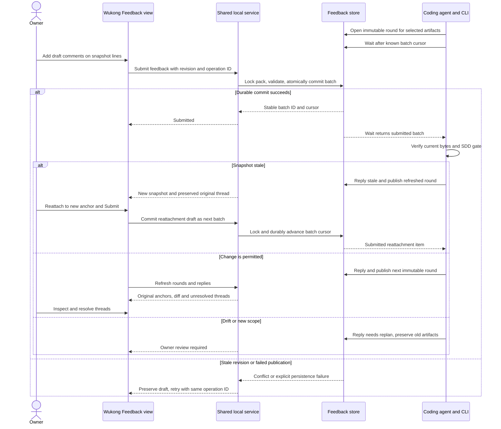
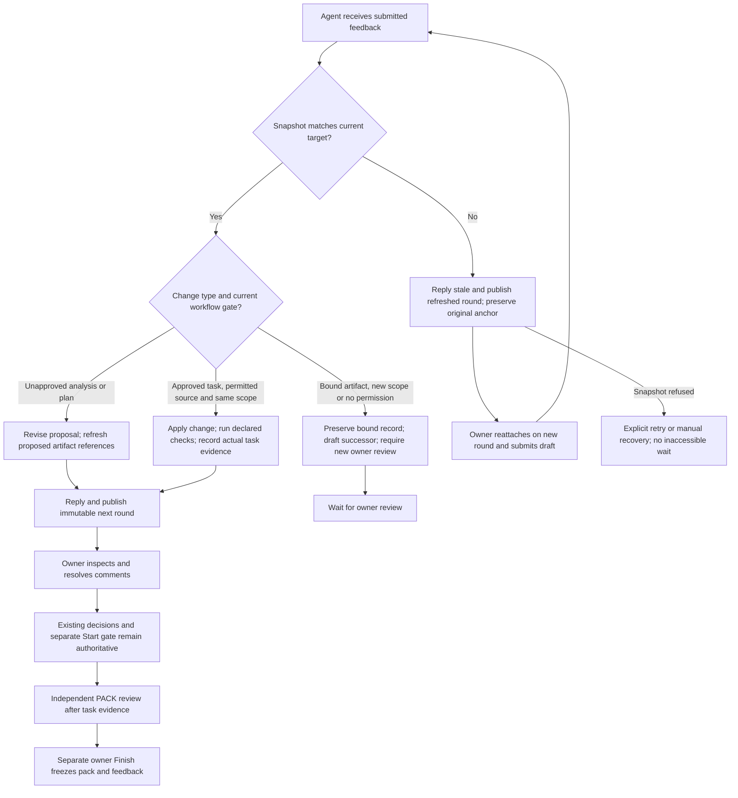

# Technical design

Depth: full design. A new file contract, browser write routes, CLI delivery and three host integrations cross multiple boundaries.
All new behavior in this document is proposed. Current relationships are evidenced in feature.md and source pins.

## Approach and alternatives

Use the existing shared web application as the owner's review surface and a portable CLI as the agent's bridge.
The owner selected native Wukong UI over Crit integration. No Crit code, dependency or automatic host registration is introduced.

| Option                              | Consequence                                                                                     | Proposal              |
| ----------------------------------- | ----------------------------------------------------------------------------------------------- | --------------------- |
| Native UI plus durable CLI protocol | One Wukong project boundary; host-independent file/command contract                             | D-1 through D-5       |
| Crit-backed UI                      | Faster reuse of review rendering, but a second service/store and authority adapter              | Not selected by owner |
| Per-host RPC/session controller     | Can target idle sessions, but adds process control, authentication and vendor-specific behavior | Outside chosen scope  |

## Architecture

DG-1 is a proposed C4 container view in portable flowchart notation. It answers which applications and stores own feedback and permission.
Trace: DES-1 through DES-5, FR-3/5/7/8. The CLI and service share feedback records; only existing owner acts affect the canonical pack.



## Data and storage — DES-1

Persist `feedback/state.json` and `feedback/rounds/<round-id>/` under the real pack directory, never additional JSON files in the pack root.
Store format is `feedback/1`. The canonical specpack remains 0.4; 0.2/0.3 are not adopted or rewritten.
All mutations acquire the existing pack lock and recheck active lifecycle, pending audit/recovery, project containment and feedback revision inside the lock.
Feedback operations never increment canonical pack revision or write owner acts. Completed packs permit safe reads but reject every feedback mutation.

The ledger contains pack identity, feedback revision, sessions, ordered immutable round manifests, drafts, immutable submitted batches, append-only replies, human resolution/reattachment events, and completed operation IDs.
A session has stable UUID, mode, selected targets and baseline identity. A round has UUID, sequence, snapshot manifest digest and creation observation time.
A target has stable UUID, normalized repository path, optional old path for rename, UTF-8 media kind, before/after snapshot hashes and stored content references.
For document mode, before is the preceding round or absent for the first round. For diff mode, before is the explicit resolved Git baseline and after is the selected worktree or explicit resolved head.

A comment stores UUID, author role/claim, body, round/target IDs, side, 1-based inclusive start/end lines, optional exact quote, snapshot hash and original round.
Round/file comments omit the line range. Line comments must identify a valid side with content and a range inside that snapshot.
An agent reply is not a resolution or proof of implemented work. Human resolution and reattachment are separate recorded events.
When target hashes change, unresolved threads retain the original snapshot and display stale; only an owner can explicitly reattach or resolve them. The agent first replies stale and publishes a refreshed round for the same selected targets/baseline. Reattach requires that open round and a valid new anchor; it appends a human event and a draft delivery item using the existing thread ID, original anchor and new anchor. Submit commits that item into the next batch and advances its cursor. The owner can also resolve the thread and submit an empty batch to return control. If snapshot publication fails or bounds refuse it, show an explicit retry/manual recovery state; never wait for reattachment to bytes the owner cannot see.

Bounds: at most 32 targets and 256 KiB per text file; 4 MiB total snapshot bytes per round; 20 rounds per session; 4 MiB ledger; 8 KiB per comment/reply body.
Count both diff sides in the round budget. Refuse oversized, binary or unsupported targets explicitly; never truncate a target while accepting its anchor.
Sessions share an 84 MiB per-pack feedback budget. No automatic deletion of original rounds or closed records.

Publish immutable round files first using an exclusive staging directory, flush their bytes, then atomically publish the ledger pointer and flush with existing platform durability discipline.
An interrupted unpublished round is an orphan, not an acknowledged success. Recovery may remove only proven unreferenced staging artifacts under the lock; corruption and incompatible format remain explicit refusals.
Every mutating operation supplies a UUID operation_id and expected feedback revision. CLI open, reply and round require an explicit agent claim; browser comment, submit, resolve and reattach use explicit human attribution under the existing local page-credential boundary. A matching previously committed operation returns the prior result before a stale-revision retry check; a changed payload for that ID conflicts.
The session remains open across rounds. Submit commits the current round’s drafts as one immutable batch and seals that round to further drafts; an empty batch explicitly means “no changes requested” and returns the agent to the normal SDD workflow without approval. Repeated submit with another operation ID for the sealed round conflicts. Only an agent publishing a new round reopens drafting. Resolving a thread records owner disposition and does not retract an already submitted batch. There is no automatic end-of-feedback owner act: the agent may end its wait on an empty batch or explicit user instruction; completed packs return closed and retain read-only history. At-least-once batch reads preserve stable IDs. The protocol does not promise exactly-once agent code edits.

## Snapshot builder and CLI — DES-2

The CLI builds snapshots from explicit selected targets. Artifact keys resolve from registered pack metadata; explicit Markdown paths resolve from the enrolled workspace.
All source and output paths undergo realpath containment checks, including existing parent directories for new files; reject symlink escapes, dot-state/credential files, .git content and self-referential feedback targets.
File/diff scope is echoed before review. Do not collect unrelated dirty hook repairs in this workspace.

Code mode requires local Git and an explicit baseline (`--base`) plus selected paths (`--file`, repeatable). Resolve baseline/head to commit object IDs; use argv execution, selected paths after `--`, and disable external diff/text conversion.
Tracked staged/unstaged changes and explicitly selected untracked additions are represented against the same immutable baseline; include old/new paths for renames and removed-side bytes for deletions.
Untracked directories, binary files, submodules and absent Git are explicit unsupported states for code mode. Document mode works without Git.
Before publication, recheck selected worktree hashes and resolved refs; source movement aborts with drift rather than publishing a misleading round.
The implementation must not claim an atomic workspace-wide snapshot while unrelated editors can write.

Proposed commands (not present today):

```text
wukong do feedback open <packDir> --mode documents --artifact plan --artifact design --expected-revision 0 --operation-id <uuid> --by agent:<host> --json
wukong do feedback open <packDir> --mode diff --base <commit> --file <repo-path> --expected-revision 0 --operation-id <uuid> --by agent:<host> --json
wukong do feedback wait <packDir> --session <uuid> --after <cursor> --timeout 30 --json
wukong do feedback read <packDir> --session <uuid> --after <cursor> --json
wukong do feedback reply <packDir> --session <uuid> --thread <uuid> --body-file <file> --expected-revision <n> --operation-id <uuid> --by agent:<host> --json
wukong do feedback round <packDir> --session <uuid> --expected-revision <n> --operation-id <uuid> --by agent:<host> --json
```

Open uses the held feedback revision (0 only for an absent ledger) and a generated operation UUID; it returns the session, revision, current cursor and exact local review URL.
Round resnapshots the session's original selection and baseline; changing selection requires a new session.
Read/wait output is `feedback-result/1` with status `pending|submitted|closed|unavailable`, pack/project/session identity, stable batch IDs/cursor and items only from submitted batches. Each item identifies its kind (`comment|reattach`), stable thread ID and immutable reviewed anchor; reattachment items also carry the preserved original anchor and human event ID. The result includes current thread disposition so a previously submitted, now resolved comment is not mistaken for a new request. Resolution never silently consumes or retracts a batch.
`pending` is a successful empty poll, never approval. Limit wait to 1–60 seconds, default 30; cancellation changes no feedback state.
A caller must preserve the returned cursor and handle redelivery by stable batch/thread IDs. Retry uses the same operation ID and body bytes.
Only the CLI creates rounds; browser requests cannot snapshot arbitrary supplied paths or run Git.

## Shared browser routes — DES-3

All routes sit under `/projects/<project-id>/library/feedback/<slug>/` on the existing shared listener.
The project and pack are selected by the route; clients cannot substitute arbitrary roots or filenames.
GET `state?session=<uuid>` returns bounded ledger presentation; GET `snapshot?session=<uuid>&round=<uuid>&target=<uuid>&side=<before|after>` serves only stored allowlisted snapshot text.
POST `comment`, `submit`, `resolve` and `reattach` use existing exact Host, Origin, page token, JSON content type and 64 KiB body limits plus operation_id and expected feedback revision.
The shared page supplies the credential; neither comments nor snapshot text receive it. Browser routes accept human feedback actions only, never agent reply/round creation or canonical owner actions under this namespace.
Agent reply/round operations remain local CLI actions with agent attribution. Claims identify actors, not authenticated identities; same-user malicious processes remain outside existing isolation guarantees.
Return 400 malformed/invalid anchor, 403 wrong origin/token/role/path boundary, 404 unknown session/target, 409 stale revision/drift/frozen/recovery and 413 bounds; preserve drafts on refusal. Reattach can select only a target in the latest open stored round, creates a draft item, and does not itself advance the submission cursor.
Read routes do not expose credentials, dot state, outside files or arbitrary source HTML. The old foreground library does not expose feedback writes and shows a shared-app link instead.

## Browser experience — DES-4

Add a Feedback view beside the existing tabs. Keep the independent Review view and owner action panel unchanged.
Show session mode, selected targets, round selector, old/new diff sides, numbered source lines, draft comments, submitted batches, agent replies and unresolved/stale counts.
Markdown preview uses the existing opaque sandbox. Line selection operates on safe source text with keyboard equivalents; comments and quotes use textContent or equivalent escaping.
Use explicit buttons: Add comment, Submit feedback, Resolve, Reattach. Never label Submit feedback as Approve, Start or Finish.
Show waiting-agent guidance, empty review, pending draft, submitted, agent response, conflict, corrupt/unavailable state and closed read-only state.
Preserve local drafts across refresh conflicts; refetch state before retry. Announce errors/submission status and retain focus predictably.
Outstanding feedback stays visible near the owner workflow, but does not introduce a hidden core approval gate or implicitly grant Start.
Render-level checks cover narrow screens, long paths, empty/binary states, keyboard operation, focus, accessible names, target size and inert malicious text.

## Agent interaction and gates — DES-5

DG-2 answers how submission becomes an agent response, including commit failure and stale-source branches. Trace: FR-3/4/5/6/8, DES-1/2/3/5.



The authoritative harness gains a feedback skill installed on Claude, Codex and Pi. It runs only when the user requests a feedback round.
The skill opens the session, supplies the exact URL, runs bounded waits, reads submitted items, checks snapshot identity and current SDD gate, replies and publishes a new round. A stale branch replies with the reason and publishes a refreshed immutable round before waiting for owner reattachment and Submit; failure to publish returns explicit retry/manual guidance rather than waiting on the sealed old round.
It never captures host transcripts, resolves comments, performs owner acts or infers approval from zero comments.
Unapproved proposal revisions use the locked authoring path. Bound artifacts require a successor proposal and renewed owner review; source changes must stay inside the admitted task and current receipt.
Add only bounded pending feedback summaries to current context; do not inject comment bodies as privileged hook instructions.
An active wait is the immediate bridge. A dormant host requires next-prompt/manual invocation; no wake-up or background execution guarantee is made.

DG-3 shows the proposed process and preserved authority. Trace: FR-4/5/11, DES-5/6, CON-2/3.



## Compatibility, delivery and rollback — DES-6

Feature writes require an active owner-gated 0.4 pack; legacy packs have unsupported write guidance, completed records are read-only.
The nested layout preserves root JSON discovery. Existing workflows and corpus bytes remain unchanged; no added specpack field or automatic adoption.
Release behind shared-app capability detection so an older runtime reports unavailable rather than guessing.
Rollback disables feedback routes and skill invocation, preserving all feedback bytes and canonical receipts. Do not delete review history or rewrite closed packs.
T-6 must witness document and code feedback for all three named hosts; a source test or fake agent is not a native witness.
T-7 runs the full repository/wiki gates and refreshes actual knowledge. Independent PACK review follows all task evidence; the owner alone chooses Finish.

## Decisions and uncertainty

D-1 through D-5 in the canonical pack are proposed; each includes alternatives and rationale. Their dependent tasks name requires_decisions.
They are reversible at the feature level, but persisted format changes need explicit migrations and preserved original records.
A-1 host wait capability, A-2 Git isolation and A-3 bounded resource behavior remain validation assumptions, not observed passes.
No unresolved human spec question remains after the two actual scope answers.

## Out of scope and diagram checks

The exclusions in spec.md apply verbatim. No remote/phone access, agent process controller, Crit dependency, legacy adoption, session capture or Windows certification is added.
Four raw Mermaid views are registered as DG artifacts. Syntax validation results and parser version go in checks/diagrams.json.
Parser success does not establish rendering in the actual Wukong Markdown view; manual readability remains a planning/implementation witness.
