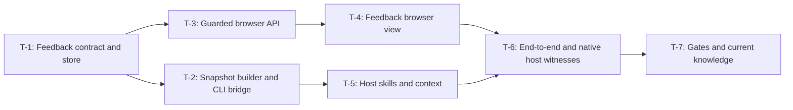

# Delivery plan

Full design is required for the new feedback format, browser write boundary and host protocol.
The canonical browser-agent-feedback.json owns task state; this Markdown describes the proposed sequence.
All seven tasks remain todo. No owner acceptance or Start receipt is inferred.

## Scope and decisions

FR-1 through FR-11 and AC-1 through AC-11 map directly to spec.md; DES-1 through DES-6 map to design.md.
D-1 store, D-2 transport, D-3 snapshots, D-4 authority and D-5 shared UI remain proposed.
The two scope answers are preserved in owner-inputs.md. Spec question membership is empty because no human behavior ambiguity remains.
A-1 through A-3 are verification assumptions, not reasons to fabricate owner questions.

## Task definitions

All verification commands below run from treadle/. Future test/verifier files are created by their owning tasks; they do not exist or pass during planning.

| Task | Outcome                                                  | Needs    | Decisions               | Requirements                                                       | Declared verification                                                                                                                              |
| ---- | -------------------------------------------------------- | -------- | ----------------------- | ------------------------------------------------------------------ | -------------------------------------------------------------------------------------------------------------------------------------------------- |
| T-1  | Define and persist the feedback contract                 | none     | D-1, D-3, D-4           | FR-2, FR-3, FR-4, FR-5, FR-6, FR-7, FR-10                          | `pnpm exec vitest run packages/core/test/feedback.test.ts`                                                                                         |
| T-2  | Build selected snapshots and the CLI bridge              | T-1      | D-1, D-2, D-3, D-4      | FR-1, FR-3, FR-4, FR-5, FR-6, FR-8, FR-10                          | `pnpm exec vitest run packages/cli/test/feedback-cli.test.ts packages/cli/test/feedback-snapshot.test.ts`                                          |
| T-3  | Expose guarded feedback browser APIs                     | T-1      | D-1, D-4, D-5           | FR-2, FR-3, FR-5, FR-6, FR-7, FR-10                                | `pnpm exec vitest run packages/web/test/feedback-api.test.ts packages/web/test/project-security.test.ts packages/web/test/project-library.test.ts` |
| T-4  | Build the browser Feedback view                          | T-3      | D-3, D-4, D-5           | FR-1, FR-2, FR-4, FR-5, FR-9                                       | `pnpm exec vitest run packages/web/test/feedback-ui.test.ts && node ../specs/browser-agent-feedback/verify-hosts.mjs --ui-only`                    |
| T-5  | Ship one feedback skill to Claude, Codex and Pi          | T-2      | D-2, D-4                | FR-5, FR-8                                                         | `pnpm exec vitest run packages/cli/test/feedback-harness.test.ts packages/cli/test/init-surfaces.test.ts`                                          |
| T-6  | Witness document and code review through all three hosts | T-4, T-5 | D-1, D-2, D-3, D-4, D-5 | FR-1, FR-2, FR-3, FR-4, FR-5, FR-6, FR-7, FR-8, FR-9, FR-10, FR-11 | `pnpm exec vitest run packages/cli/test/feedback-loop.test.ts && node ../specs/browser-agent-feedback/verify-hosts.mjs`                            |
| T-7  | Verify delivery and refresh current knowledge            | T-6      | D-4                     | FR-5, FR-10, FR-11                                                 | `node ../specs/browser-agent-feedback/verify-delivery.mjs`                                                                                         |

T-4 also requires actual rendered UI/keyboard evidence through `verify-hosts.mjs --ui-only`.
T-6 also runs `verify-hosts.mjs`, which must refuse absent native host evidence.
T-7 authors the delivery verifier before running it; it records every command/exit and refuses missing gates or insufficient coverage.
T-4 and T-6 bind both required checks into their single canonical verify.cmd with failure propagation. The current core validates evidence against that command; verify.steps supplies explanation and does not independently enforce completion. A unit-only evidence row cannot satisfy these tasks. No host loop, review or UI witness is claimed during planning.

## Delivery DAG

DG-4 answers which produced contracts unlock the next slices. Arrows are canonical needs edges, not execution permission.
T-1 is the structural entry. CLI/harness and API/UI branches join at T-6; T-7 follows complete witnesses.

## Allowed file changes and context

The following scopes are exhaustive. Paths resolve from the Git root. New paths are explicit and stay unpinned while absent until their task handout.
Each task reads brief.md, feature.md, spec.md, design.md and this plan, SECURITY.md and core workflow.ts.
Wiki context is systems/sdd-harness-architecture, systems/owner-workflow and domain/policy-no-session-capture-in-engine.
Read and wiki context are advisory; touch files pin at handout. Progress and actual evidence belong in execution-log.md and the canonical record.

### T-1: Define and persist the feedback contract

Store transitions, anchor validity, lock/revision/idempotency, crash recovery, bounds and frozen-pack refusal pass; canonical receipts/bytes stay unchanged. Stale reattachment becomes a draft on a fresh round and advances delivery only on Submit.

Allowed touch paths:

- `treadle/packages/core/src/feedback/model.ts`
- `treadle/packages/core/src/feedback/store.ts`
- `treadle/packages/core/src/feedback/index.ts`
- `treadle/packages/core/src/index.ts`
- `treadle/packages/core/test/feedback.test.ts`

### T-2: Build selected snapshots and the CLI bridge

Document/Git selections, rename/delete/add sides, source drift, no external diff execution, JSON statuses, cursor redelivery, cancellation and timeout pass. Sealed/stale recovery publishes a readable new round before waiting, or refuses explicitly.

Allowed touch paths:

- `treadle/packages/cli/src/commands/feedback.ts`
- `treadle/packages/cli/src/harness/feedback-snapshot.ts`
- `treadle/packages/cli/src/commands/do.ts`
- `treadle/packages/cli/test/feedback-cli.test.ts`
- `treadle/packages/cli/test/feedback-snapshot.test.ts`

### T-3: Expose guarded feedback browser APIs

Existing shared guards, project isolation, snapshot allowlist, feedback role actions, conflict and recovery behavior pass without source or owner-state writes.

Allowed touch paths:

- `treadle/packages/web/src/feedback.ts`
- `treadle/packages/web/src/project-server.ts`
- `treadle/packages/web/test/feedback-api.test.ts`

### T-4: Build the browser Feedback view

All specified review states, keyboard selection, focus/labels, draft preservation, inert malicious text and separate owner controls pass; rendered responsive/manual evidence is attached.

Allowed touch paths:

- `treadle/packages/web/src/feedback.js`
- `treadle/packages/web/src/library.js`
- `treadle/packages/web/src/library.html`
- `treadle/packages/web/src/project-server.ts`
- `treadle/packages/web/test/feedback-ui.test.ts`
- `specs/browser-agent-feedback/verify-hosts.mjs`
- `specs/browser-agent-feedback/host-witnesses.md`

### T-5: Ship one feedback skill to Claude, Codex and Pi

Installer updates all three feedback skills from authoritative source; bounded summaries, explicit invocation, pending timeout and no owner/session capture behavior pass.

Allowed touch paths:

- `treadle/packages/cli/harness/skills/sdlc/feedback/SKILL.md`
- `treadle/packages/cli/harness/skills/sdlc/feedback/resources/protocol.md`
- `treadle/packages/cli/harness/harness.json`
- `treadle/packages/cli/src/harness/context.ts`
- `treadle/packages/cli/test/feedback-harness.test.ts`
- `.claude/skills/feedback/SKILL.md`
- `.claude/skills/feedback/resources/protocol.md`
- `.codex/skills/feedback/SKILL.md`
- `.codex/skills/feedback/resources/protocol.md`
- `.pi/skills/feedback/SKILL.md`
- `.pi/skills/feedback/resources/protocol.md`

### T-6: Witness document and code review through all three hosts

Automated document/diff/restart/drift and SDD gate cases pass; host verifier separately requires actual Claude/Codex/Pi document and code witnesses, human submissions/resolution and commands/exits. Witness stale-source refresh, human reattachment and cursor delivery without an inaccessible wait.

Allowed touch paths:

- `treadle/packages/cli/test/feedback-loop.test.ts`
- `specs/browser-agent-feedback/verify-hosts.mjs`
- `specs/browser-agent-feedback/host-witnesses.md`

### T-7: Verify delivery and refresh current knowledge

All six repository gates and five wiki checks pass, coverage floors hold, 0 wiki errors/warnings/review anchors and fresh stamp; current docs describe actual verified behavior.

Allowed touch paths:

- `wiki/systems/sdd-harness-architecture.md`
- `wiki/systems/owner-workflow.md`
- `wiki/initiatives/browser-agent-feedback.md`
- `wiki/initiatives/index.md`
- `wiki/.okf/fingerprints.json`
- `wiki/.okf/last-index.json`
- `treadle/packages/cli/harness/hooks/README.md`
- `specs/browser-agent-feedback/verify-delivery.mjs`
- `specs/browser-agent-feedback/execution-log.md`

## Traceability and deferred scope

Every FR/AC appears in canonical tasks[].satisfies/accepts and in a DES element's addresses.
T-6 repeats the cross-boundary acceptance journey; unit checks alone cannot discharge native-host requirements.
All exclusions in spec.md remain deferred. Windows certification, remote access, live-app review and idle-session control require a separate analysis/owner decision.

## Full owner journey

1. Read the brief, analysis, candidate spec and actual scope answers.
2. Review design and all task definitions; accept or reject D-1 through D-5 in Wukong.
3. Separately choose Start implementation for this exact plan digest.
4. The agent obtains one admitted task/handout, verifies frozen source context, implements its scope and records actual checks.
5. After all tasks and host witnesses, an independent reviewer records PACK review for current plan and evidence digests.
6. The owner separately chooses Finish spec in the Review view; canonical pack and feedback history become read-only.

A review batch, agent reply or empty unresolved-comment count cannot perform steps 2, 3, 5 or 6.
A changed bound plan uses a successor proposal and renewed Start permission. Do not silently repin or bypass a refused gate.
The harness-host-acceptance backlog is separate; its deferred native release coverage is not declared completed by this slice.

## Proposal validation and handoff

The actual schema/alignment/DAG/reference/diagram and repository/wiki checks are recorded under checks/ and review.md.
Structural entry set: T-1 only. The expected machine gate is decisions, then separate Start; this must be observed after reload.
The next action is owner review of the concrete proposal, not do next or implementation.
No source implementation, owner action, host activation or completion claim is made by this planning artifact.
